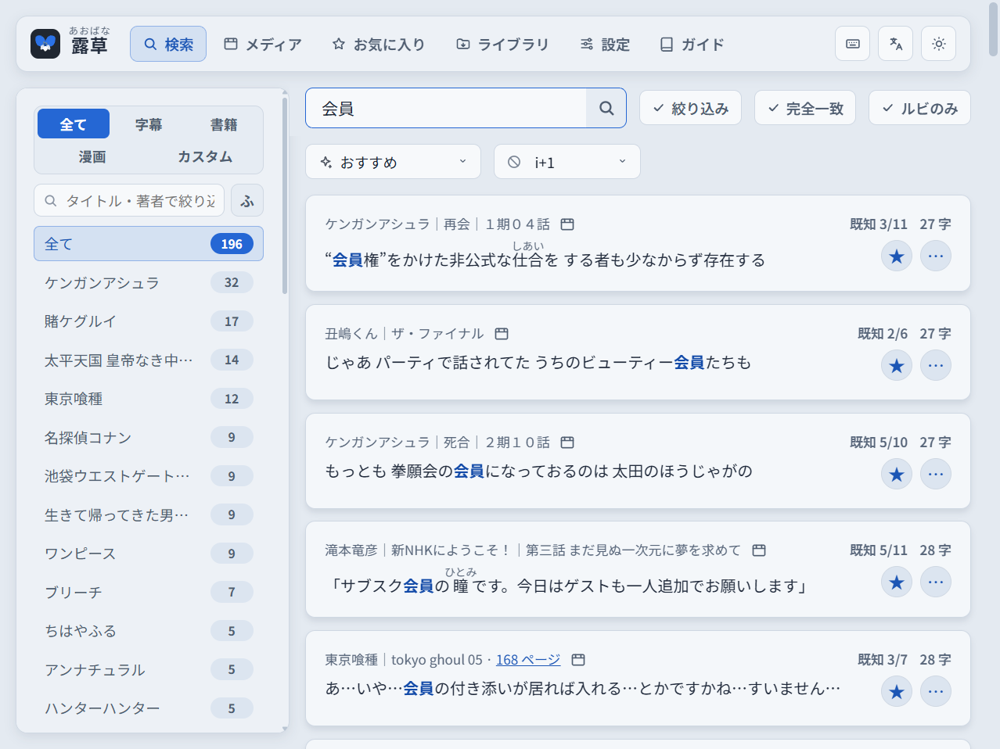
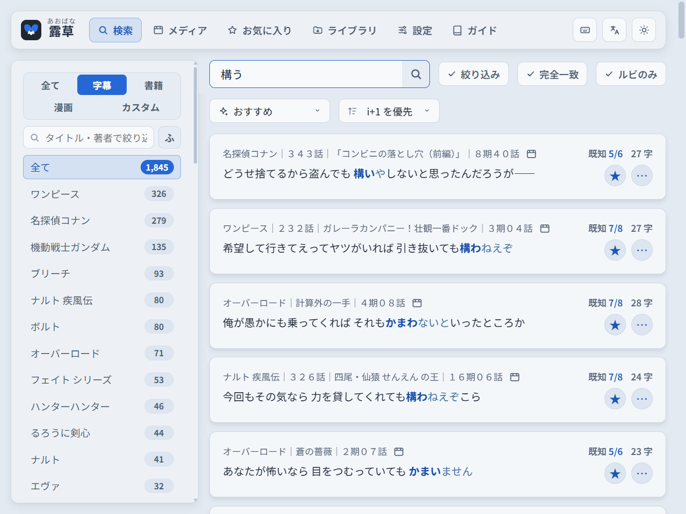
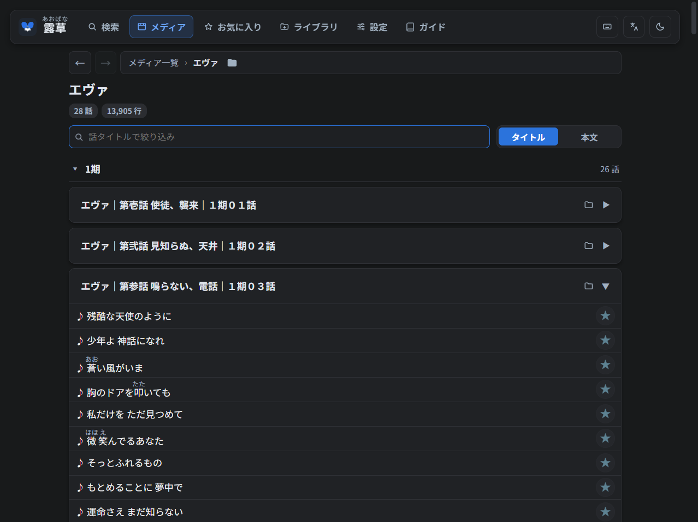

<p align="center">
  
</p>

<h1 align="center">露草 Aobana</h1>

<p align="center"><b>手持ちの字幕・電子書籍・漫画・テキストが、そのまま日本語の例文集に。</b></p>

<p align="center">
  <a href="https://github.com/Wyzmic/Aobana/releases/latest"></a>
  <a href="LICENSE"></a>
</p>

<p align="center"><a href="README.md">English</a> | 日本語</p>

---

露草（あおばな）は、お手持ちの字幕ファイル・電子書籍・漫画・テキストファイルから日本語の例文を探せる、オフラインの例文検索アプリです。
処理はすべてお使いのパソコンの中で完結し、ライブラリの本文をインターネットに送信しません。更新の確認は GitHub に問い合わせ、リリースページを案内するか、更新を選んだときにダウンロードします。



## 主な機能
- **自分だけのライブラリ** — 字幕（`.srt`・`.ass`・`.ssa`）、電子書籍（`.epub`）、漫画（`.mokuro`）を、それぞれ指定したフォルダ（複数可）から取り込みます。使わないメディアはオフにできます。`.ass`・`.ssa` からは日本語の台詞を、ふりがなと一緒に読み込みます。`.mokuro` は [mokuro](https://github.com/kha-white/mokuro) が漫画の画像を OCR して書き出すファイルで、画像は必要ありません。
- **カスタム** — お手持ちの `.txt` と Markdown（`.md`）のファイル（メモや Notion の書き出しなど）を、ほかのメディアと同じように検索して読めます。設定タブでオンにすると使えます。
- **活用形もまとめて検索** — `食べる` で検索すると「食べた」「食べて」もヒットし、読みの `たべる` でも探せます。語と読みを `＝` でつなぐと、その読みの箇所だけを探せます（`好く＝すく`）。完全一致検索や、`ー`（伸ばし棒。`-` でも可）を付けた語の除外にも対応しています。
- **既知語と i+1** — 知っている単語を、設定タブの「既知語」に読み込めます。1行に1語のテキスト、Anki の書き出し、Jiten・Migaku の書き出しのほか、Aobana Reibun 1.2 以降を入れた Anki のデッキからも取り込めます。「i+1 を優先」か「i+1 のみ」を選ぶと、検索した語だけが知らない語である例文を先に表示し、各結果に既知語の数を表示します。
- **ふりがな** — 日本語の本文にふりがなを表示します。ルビ付きの書籍では、作者が振ったルビをそのまま使います。ボタン一つで非表示にもできます。
- **前後の文脈** — 例文の前後の台詞や文を確認できます。メディアタブで開くと、その話・章を頭から通して読めます。「フォルダを開く」で、ファイルの保存場所を開けます。
- **お気に入り・並べ替え・絞り込み** — 気に入った例文を保存できます。並び順は「おすすめ」「時系列順」「長い順」「短い順」「ランダム」から選べ、1つのメディアだけ・特定の作品だけに絞り込んで検索することもできます。
- **日本語・英語の表示切り替え**、4種類のテーマ、キーボードショートカットに対応。

## Anki アドオン: Aobana Reibun
[Aobana Reibun](https://ankiweb.net/shared/info/1429349152)（例文）は、Anki のカードに日本語の例文を入れるアドオンです。Aobana を使うと、手持ちの字幕・書籍・漫画・カスタムのファイルから例文を選び、ふりがな、作品名、前後の文脈を、漫画ならそのページの画像も一緒に入れます。Nadeshiko と Immersion Kit からも、スクリーンショットと音声つきの例文を入れられます。デッキ全体にまとめて入れることも、復習中のカードにホットキー1つで入れることもできます。

インストールは、Anki の **ツール → アドオン** で **アドオンを入手...** を押し、コード **1429349152** を入力します。ソースとガイド: [Wyzmic/Aobana-Reibun](https://github.com/Wyzmic/Aobana-Reibun)。

## スクリーンショット
字幕から「構う」を「i+1 を優先」で検索したところ。「構う」だけが知らない語である例文が、活用形も含めて先に並びます:



メディアタブで作品の話を期ごとに並べ、1話を開いて台詞を順に読む（テーマ「夜」）:



## インストール（Windows 10 / 11、64ビット版）
1. [最新リリース](https://github.com/Wyzmic/Aobana/releases/latest)から `Aobana-Setup-<バージョン>.exe` をダウンロードして実行します。コード署名をしていないため、「WindowsによってPCが保護されました」と表示されることがあります。その場合は「詳細情報」をクリックし、「実行」を押してください。
2. セットアップの案内に従います。Python などの必要なものはすべて同梱されているので、事前のインストールは不要で、オフラインでも動作します。
3. **Aobana** を起動すると、ブラウザで `http://127.0.0.1:5000/` が開きます。初回は、使うメディアとそのフォルダの場所を確認します。Aobana の起動中は小さなコンソールウィンドウが開いており、このウィンドウを閉じると終了します。

ライブラリは、初回に別のフォルダを選ばない限り `ドキュメント\Aobana\Subtitles`・`ドキュメント\Aobana\Books`・`ドキュメント\Aobana\Manga`・`ドキュメント\Aobana\Custom` に、データベースと設定は `%LOCALAPPDATA%\Aobana` に置かれます。フォルダは設定タブから変更できます。アンインストールは、Windows の **設定 → アプリ** から行います。プログラムと一緒に削除するものを選べ、ご自身で選んだフォルダは削除されません。

## インストール（macOS、Apple シリコン）
1. [最新リリース](https://github.com/Wyzmic/Aobana/releases/latest)から `Aobana-<バージョン>-macos-arm64.dmg` をダウンロードして開き、**Aobana** を「アプリケーション」フォルダにドラッグします。
2. Aobana を開きます。Apple の署名がないため、初回は macOS に開くのを止められます。「システム設定」→「プライバシーとセキュリティ」を開き、下のほうにある Aobana の「このまま開く」をクリックしてください（ターミナルで `xattr -dr com.apple.quarantine /Applications/Aobana.app` を実行しても開けるようになります）。
3. Aobana はターミナルのウィンドウで起動し、ブラウザで `http://127.0.0.1:5005/` が開きます（macOS では 5000 番を AirPlay レシーバーが使っているため、5000 ではありません）。ターミナルのウィンドウを閉じると終了します。

ライブラリは、初回に別のフォルダを選ばない限り `書類/Aobana/Subtitles`・`書類/Aobana/Books`・`書類/Aobana/Manga`・`書類/Aobana/Custom` に、データベースと設定は `~/Library/Application Support/Aobana` に置かれます。フォルダは設定タブから変更できます。Intel 搭載の Mac では、ソースから実行してください。

## インストール（Linux、x86-64）
[最新リリース](https://github.com/Wyzmic/Aobana/releases/latest)には2種類あります。中身は同じで、Ubuntu 22.04・24.04 と Fedora でビルドとテストを行っています。
- **`Aobana-<バージョン>-linux-x86_64.tar.gz`**（おすすめ）: 展開したフォルダで `./install.sh` を実行します。アプリケーションメニューに **Aobana** が、コマンドとして `aobana` が追加されます。アップデートは新しいバージョンの `install.sh` を実行し、アンインストールは `~/.local/share/aobana-app/uninstall.sh` を実行します。
- **`Aobana-<バージョン>-x86_64.AppImage`**: ファイル1つで、インストールは不要です。実行可能にして（`chmod +x`）実行します。FUSE がないと表示された場合は、`--appimage-extract-and-run` を付けて実行してください。

Aobana はターミナルのウィンドウで動作し、そのウィンドウを閉じると終了します。ライブラリは、初回に別のフォルダを選ばない限り `~/Documents/Aobana/Subtitles`・`~/Documents/Aobana/Books`・`~/Documents/Aobana/Manga`・`~/Documents/Aobana/Custom` に、データベースと設定は `~/.local/share/aobana` に置かれます。

## 使い方
1. **ファイルを置く** — 字幕は、字幕フォルダの中に作品ごとのフォルダを作って入れてください。フォルダ名がそのまま作品名になります。字幕フォルダの直下に置いた字幕ファイルは、ファイル名を作品名とする1つの作品として読み込まれます。書籍は書籍フォルダ内のどこに置いても構いません。漫画は、漫画フォルダの中にシリーズごとのフォルダを作り、1巻につき1つの `.mokuro` ファイルを入れてください。自分の `.txt`・`.md` ファイルはカスタムフォルダに入れます。中に作ったフォルダは、その名前のカテゴリになります。
   ```
   字幕フォルダ/
   ├─ 作品A/
   │   ├─ 作品A S01E01.srt
   │   └─ 作品A S01E02.srt
   └─ 作品B/
       └─ 第1期/
           └─ 作品B 第01話.srt

   書籍フォルダ/
   └─ [著者名] 書名.epub

   漫画フォルダ/
   └─ シリーズA/
       ├─ シリーズA 01.mokuro
       └─ シリーズA 02.mokuro

   カスタムフォルダ/
   └─ 歌詞/
       ├─ 曲A.txt
       └─ メモ.md
   ```
2. **インデックスを作成する** — ライブラリタブの「インデックス作成」を押します。ファイルが増えるときは、作成前にデータベースの大きさと所要時間を見積もり、合計が 10 GB を超えそうな場合は確認します。2回目以降は、変更のあったファイルだけを読みます。作成中は進み具合が表示され、「中止」しても終わった分はそのまま残ります。

   同じタブの「点検する」は、同じエピソードや本の別ファイル（残すのにおすすめの1つ付き）、日本語でないファイル、UTF-8 でない字幕（元のファイルをバックアップに残して変換できます）、読めないファイルとその理由を一覧にします。外すものにチェックを付けて保存ボタンを押すまで何も変わらず、ファイルの移動や削除はしません。外したものはあとで戻せます。「次回の対象にする」は、次の「インデックス作成」で読み直すファイルを指定します。
3. **検索する** — タブを切り替えても検索は止まりません。

メディアタブでは、「← メディア一覧」やブラウザの戻る操作で、一覧と見ていた位置に戻れます。期・OVA・劇場版は、フォルダ名やファイル名に書かれていればまとめて表示します。上部の選択中の検索・メディアアイコンを押すと先頭に戻り、**Q** で検索欄に移動します。字幕は UTF-8、UTF-16、Shift-JIS、EUC-JP、ISO-2022-JP に対応しています。

そのほかの使い方は、アプリ内のガイドタブで説明しています。

## Android（Termux）
Aobana は Android スマートフォンでも動作し、端末のブラウザで開きます。Firefox なら、Yomitan などのポップアップ辞書と組み合わせて使うこともできます。

必要なもの:
- Termux と Termux:Widget（Google Play 版か [F-Droid](https://f-droid.org/packages/com.termux/) 版のどちらか。2つのアプリは必ず同じストアから入れてください。ストアが異なると連携できません）
- 約 1.5 GB の空き容量

1. **インストール** — 次のコマンドを Termux に貼り付けて実行し、ストレージへのアクセスを求められたら許可します。
   ```bash
   curl -fsSL https://raw.githubusercontent.com/Wyzmic/Aobana/main/termux/install.sh | bash
   ```
   Termux 内に小さな Ubuntu 環境を用意し（形態素解析器の Sudachi に Android 版がないため）、そこに Python と、バージョンを固定したパッケージをインストールします。Aobana の動作に必要なファイルだけが `/storage/emulated/0/Aobana` に置かれ、Termux:Widget 用の **Aobana** ショートカットが追加されます。アップデートするときも、同じコマンドを実行するだけです。1.9 以降は、新しいバージョンが出るとページに「今すぐ更新」が表示され、押すだけで更新して再読み込みされます。それより前のバージョンでは、このコマンドを実行してください。
2. **ライブラリを用意する** — パソコン版の Aobana で作成した `subs.db`・`epub.db`・`manga.db`・`custom.db` を、上記のフォルダ内の `data/db` フォルダにコピーします（いちばん速く、検索結果もパソコンと同じになります）。または、そのフォルダの `content/Subtitles`・`content/Books`・`content/Manga` にファイルを入れ（自分の `.txt`・`.md` は、設定タブでカスタムをオンにしてから `content/Custom` フォルダに）、ライブラリタブで「インデックス作成」を押します（スマートフォンでは時間がかかります）。
3. **起動する** — ホーム画面に Termux:Widget のウィジェットを追加し、**Aobana** をタップします。Firefox がインストールされていれば Firefox で、なければ既定のブラウザで開きます。ブラウザが開かない場合は、Android の設定で Termux の「他のアプリの上に重ねて表示」を許可してください。Termux を閉じると Aobana も終了します。

**アンインストール** — Aobana 用の Ubuntu 環境、ショートカット、Aobana のプログラムファイルを削除します。Aobana のフォルダにはデータベース、メディア、設定だけが残るので、不要であれば手動で削除してください。
```bash
curl -fsSL https://raw.githubusercontent.com/Wyzmic/Aobana/main/termux/uninstall.sh | bash
```

## ソースから実行する（Windows・macOS・Linux）
リリース版は Python 3.14 でビルド・動作確認をしています。
```bash
git clone https://github.com/Wyzmic/Aobana.git
cd Aobana
pip install -r requirements.txt -c constraints.txt
python -m aobana
```
ソースから実行した場合、メディアフォルダはクローンしたフォルダの `content/Subtitles`・`content/Books`・`content/Manga`・`content/Custom` になり、データベースと設定は `data/` に作成されます。フォルダは設定タブから変更できます。

`requirements.txt` と `constraints.txt` のバージョン指定は変えないでください。すべての文をどう区切ってインデックスするかは Sudachi の辞書で決まるため、辞書だけを更新すると検索結果が変わってしまいます。`constraints.txt` を付けると、リリース版のビルドと同じバージョンがインストールされます。

Windows 用インストーラーを自分でビルドする手順は、`release/build.py` を参照してください。macOS 版と Linux 版は `release/build_unix.py` でビルドされ、GitHub のワークフローがこれを実行します。

## 追加のルビデータ
`data/ruby/ruby.tsv` には、ふりがなを正しい文字の上に表示するための、語の小さなタブ区切りの表が入っています。これらの語は Sudachi の辞書にまだ収録されていないため、表がなければふりがなが違う文字の上に表示されてしまいます。表示の正確さを高めるための、開発者による取り組みです。

## ご要望・不具合の報告
追加してほしい機能のアイデアや、おかしな動作の報告を歓迎します。どちらも [Issue](https://github.com/Wyzmic/Aobana/issues) からお知らせください。

## 謝辞
- [Nadeshiko](https://github.com/BrigadaSOS/Nadeshiko) — 多くの機能は、この例文検索サービスを参考にしています。
- [Sudachi](https://github.com/WorksApplications/sudachi.rs) とその辞書 — 形態素解析に使用しています。
- [Noto Sans JP](https://fonts.google.com/noto/specimen/Noto+Sans+JP) — 同梱のフォントです。

サードパーティ製ソフトウェアのライセンスは [THIRD_PARTY_NOTICES.md](THIRD_PARTY_NOTICES.md) に記載しています。

## 著作権について
- Aobana には、字幕や書籍は一切含まれていません。お使いのパソコン内のファイルをインデックスするだけのアプリです。利用する権利のあるファイルでのみご利用ください。
- スクリーンショットでは、アプリの動作を紹介するために、開発者自身のライブラリから短い台詞や文を数点引用しています。作品名および内容の権利は、各権利者に帰属します。
- 掲載内容の権利者の方で削除をご希望の場合は、[Issue](https://github.com/Wyzmic/Aobana/issues) でお知らせください。該当の画像を差し替えます。
- Aobana は、ライブラリの本文を収集したり外部へ送信したりしません。更新の確認では GitHub に問い合わせ、更新するときは新しいバージョンをダウンロードします。

## ライセンス
[GPL-3.0](LICENSE)
