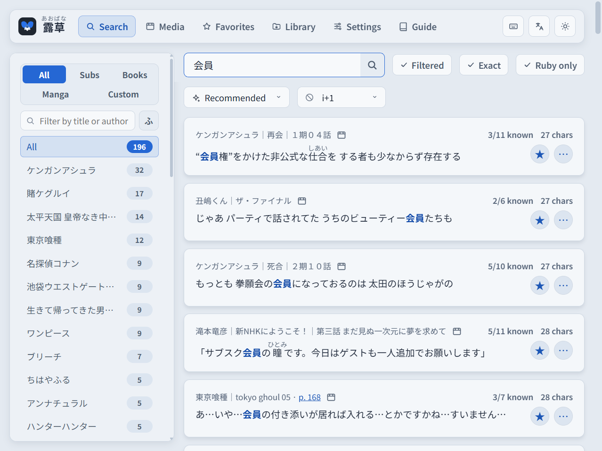
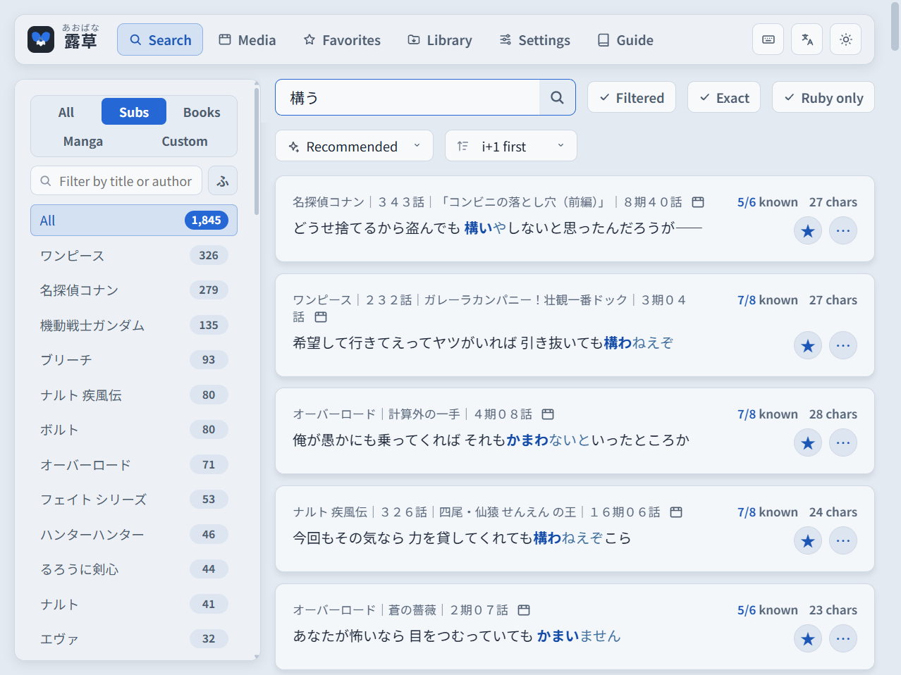
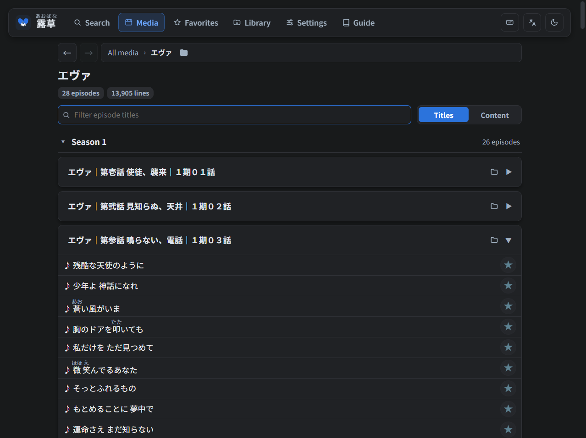

<p align="center">
  
</p>

<h1 align="center">露草 Aobana</h1>

<p align="center"><b>Japanese example sentences from the subtitles, e-books, manga and text files you own.</b></p>

<p align="center">
  <a href="https://github.com/Wyzmic/Aobana/releases/latest"></a>
  <a href="LICENSE"></a>
</p>

<p align="center">English | <a href="README.ja.md">日本語</a></p>

---

Aobana (露草, *あおばな*) is an offline search engine for Japanese example sentences, built from
the subtitle files, e-books, manga and text files you own. Everything runs on your own computer and
no library text is sent to the internet. Update checks ask GitHub whether a newer version exists,
and offer the release page, or download an update when you choose to update.



## Features
- **Your own library:** subtitles (`.srt`, `.ass`, `.ssa`), e-books (`.epub`) and manga (`.mokuro`), each indexed from one or more folders you choose; turn off what you don't use. From an `.ass` or `.ssa`, only the Japanese dialogue is read, with its furigana. A `.mokuro` file is what [mokuro](https://github.com/kha-white/mokuro) writes when it runs OCR on manga pages; the images are not needed.
- **Custom:** your own `.txt` and Markdown (`.md`) files, such as notes or a Notion export, searched and read like the other media. It is off until you turn it on in the Settings tab.
- **Search that understands Japanese:** `食べる` also finds 食べた and 食べて, and the reading `たべる` works too. Join a word and its reading to find only that reading: `好く＝すく`. Exact matches, and excluding a word with `-`.
- **Known words and i+1:** load the words you already know under **Known words** in the Settings tab: a list with one word per line, an Anki export, a Jiten or Migaku export, or your Anki decks through Aobana Reibun 1.2 or later. Then **i+1 first** or **i+1 only** puts forward the sentences where the word you searched is the only one you do not know, and each result shows how many of its words you know.
- **Furigana:** readings above Japanese text, from the author's own ruby where the book has it. One click turns it off.
- **Context:** open the lines around any sentence, or open it in the Media tab and read the whole episode or chapter in order. **Open folder** shows where a file is on your computer.
- **Favorites, sorting and filters:** save sentences; sort them by recommended, chronological, longest, shortest or random; search one media or all of them, or inside a single title.
- **Japanese and English UI**, four themes, keyboard shortcuts.

## Anki add-on: Aobana Reibun
[Aobana Reibun](https://ankiweb.net/shared/info/1429349152) fills your Anki cards with Japanese example sentences. With Aobana it picks them from your own subtitles, books, manga and Custom files, with furigana, the title they come from, the lines around them, and for manga the page's image; it also takes sentences with screenshots and audio from Nadeshiko and Immersion Kit. It backfills a whole deck at once, or the card you are reviewing with one hotkey.

To install it, open **Tools → Add-ons** in Anki, press **Get Add-ons...** and enter the code **1429349152**. Its source and guide: [Wyzmic/Aobana-Reibun](https://github.com/Wyzmic/Aobana-Reibun).

## Screenshots
Searching subtitles for 構う with **i+1 first**: the sentences where 構う is the only word you don't know come first, in any of its forms:



The Media tab: a show's episodes by season, one opened to read its lines in order, in the Night theme:



## Install (Windows 10 / 11, 64-bit)
1. Download `Aobana-Setup-<version>.exe` from the [latest release](https://github.com/Wyzmic/Aobana/releases/latest) and run it. It is not code-signed, so Windows SmartScreen may say *"Windows protected your PC"*: click **More info**, then **Run anyway**.
2. Follow the setup. Python and everything else is included, so nothing needs to be installed first, and it works offline.
3. Start **Aobana**. It opens in your browser at `http://127.0.0.1:5000/`, and the first time asks which media you use and where their folders go. Aobana runs in a small console window; close it to quit.

Your library goes in `Documents\Aobana\Subtitles`, `Documents\Aobana\Books`, `Documents\Aobana\Manga` and `Documents\Aobana\Custom` unless you choose other folders at the first start, and the databases and settings in `%LOCALAPPDATA%\Aobana`. You can change the folders in the Settings tab. To uninstall, open **Settings → Apps** in Windows: the uninstaller asks which of these to delete along with the program, and never deletes a folder you chose yourself.

## Install (macOS, Apple Silicon)
1. Download `Aobana-<version>-macos-arm64.dmg` from the [latest release](https://github.com/Wyzmic/Aobana/releases/latest), open it, and drag **Aobana** into **Applications**.
2. Open Aobana. It is not signed by Apple, so the first time macOS refuses to open it: open **System Settings → Privacy & Security**, scroll down, and click **Open Anyway** next to Aobana. (Or, in Terminal: `xattr -dr com.apple.quarantine /Applications/Aobana.app`.)
3. Aobana starts in a Terminal window and opens in your browser at `http://127.0.0.1:5005/` (not 5000, which macOS's AirPlay Receiver uses). Close the Terminal window to quit.

Your library goes in `Documents/Aobana/Subtitles`, `Documents/Aobana/Books`, `Documents/Aobana/Manga` and `Documents/Aobana/Custom` unless you choose other folders at the first start, and the databases and settings in `~/Library/Application Support/Aobana`. You can change the folders in the Settings tab. Intel Macs: run from source.

## Install (Linux, x86-64)
Two downloads on the [latest release](https://github.com/Wyzmic/Aobana/releases/latest), the same app in each, built and tested on Ubuntu 22.04 and 24.04 and Fedora.
- **`Aobana-<version>-linux-x86_64.tar.gz`** (recommended): unpack it and run `./install.sh` in the unpacked folder. That adds **Aobana** to your applications menu and an `aobana` command. Run the new version's `install.sh` to update, and `~/.local/share/aobana-app/uninstall.sh` to remove it.
- **`Aobana-<version>-x86_64.AppImage`**: one file, nothing installed. Make it executable (`chmod +x`) and run it. If it says FUSE is missing, run it with `--appimage-extract-and-run`.

Aobana runs in a terminal window; close the window to quit. Your library goes in `~/Documents/Aobana/Subtitles`, `~/Documents/Aobana/Books`, `~/Documents/Aobana/Manga` and `~/Documents/Aobana/Custom` unless you choose other folders at the first start, and the databases and settings in `~/.local/share/aobana`.

## Usage
1. **Add files.** Give each show its own folder inside the subtitles folder: the folder's name becomes the show's name. A subtitle file placed directly in the subtitles folder is read as a show of its own, named after the file. Books can go anywhere in the books folder. Give each manga series its own folder inside the manga folder, one `.mokuro` file per volume. Your own `.txt` and `.md` files go in the Custom folder; a folder inside it is a category, named after the folder.
   ```
   Subtitles folder/
   ├─ Show A/
   │   ├─ Show A S01E01.srt
   │   └─ Show A S01E02.srt
   └─ Show B/
       └─ Season 1/
           └─ Show B 第01話.srt

   Books folder/
   └─ [Author] Title.epub

   Manga folder/
   └─ Series A/
       ├─ Series A 01.mokuro
       └─ Series A 02.mokuro

   Custom folder/
   └─ Lyrics/
       ├─ Song A.txt
       └─ Notes.md
   ```
2. **Build the index.** Press **Index library** in the Library tab. Before a run that adds files, Aobana estimates how big the index will get and how long it will take, and asks first if the databases would pass 10 GB. Later runs only read files that changed. While it runs you can see what it is doing, and **Stop** keeps everything finished so far.

   **Check library**, in the same tab, lists copies of the same episode or book with one recommended to keep, files that aren't in Japanese, subtitles that aren't UTF-8 (which it can convert, keeping the original as a backup), and files that can't be read, with the reason. Nothing changes until you tick what to leave out and press the save button; no file is moved or deleted, and anything left out can be put back. **Add to next index** marks files to be read again at the next **Index library**.
3. **Search.** A search keeps running when you switch tabs.

In the Media tab, **← All media** and the browser's Back button bring back the list and your place in it. Seasons, OVAs and films are grouped when their folder or file names say so. Clicking the active Search or Media icon at the top scrolls back up, and **Q** jumps to the search box. Subtitles can be UTF-8, UTF-16, Shift-JIS, EUC-JP or ISO-2022-JP.

The Guide tab explains the rest.

## Android (Termux)
Aobana runs on an Android phone and opens in your browser there, so a pop-up dictionary such as Yomitan works on it in Firefox. It needs about 1.5 GB free, and Termux and Termux:Widget from the same store, Google Play or [F-Droid](https://f-droid.org/packages/com.termux/): builds from different stores cannot work together.

1. **Install** — paste this into Termux, and allow storage access when asked:
   ```bash
   curl -fsSL https://raw.githubusercontent.com/Wyzmic/Aobana/main/termux/install.sh | bash
   ```
   It sets up a small Ubuntu inside Termux (the Sudachi analyzer has no Android build), installs Python and the pinned packages there, puts the files Aobana runs from (nothing else) in `/storage/emulated/0/Aobana`, and adds an **Aobana** shortcut for the Termux:Widget widget. Run the same command again to update; from 1.9 on, when a new version is out, the page offers **Update now**, which does that for you and reloads. On an older version, run the command yourself.
2. **Add your library** to that folder: copy `subs.db`, `epub.db`, `manga.db` and `custom.db` into its `data/db` folder from a computer where Aobana has indexed it (fastest, and identical results), or put files in `content/Subtitles`, `content/Books` and `content/Manga` there (your own `.txt` and `.md` in a `content/Custom` folder, once Custom is on in the Settings tab) and press **Index library** in the Library tab (slow on a phone).
3. **Start** — add the Termux:Widget widget to your home screen and tap **Aobana**. The page opens in Firefox if it is installed, otherwise in your default browser. If no browser opens, allow Termux *Display over other apps* in Android's settings. Closing Termux stops Aobana.

**Uninstall** — removes Aobana's Ubuntu, the shortcut and the app's files; in the Aobana folder only your databases, media and settings stay, for you to delete if you no longer want them:
```bash
curl -fsSL https://raw.githubusercontent.com/Wyzmic/Aobana/main/termux/uninstall.sh | bash
```

## Run from source (Windows, macOS, Linux)
Python 3.14 is what the release is built and tested with.
```bash
git clone https://github.com/Wyzmic/Aobana.git
cd Aobana
pip install -r requirements.txt -c constraints.txt
python -m aobana
```
From a source folder, the media folders are `content/Subtitles`, `content/Books`, `content/Manga` and `content/Custom` in the cloned folder, and the databases and settings go in `data/`. You can point the folders elsewhere from the Settings tab. The pins in `requirements.txt` and `constraints.txt` matter: the Sudachi dictionary decides how every sentence is indexed, so do not upgrade it on its own, and `constraints.txt` installs the same versions the release is built with.

To build the Windows installer yourself, see `release/build.py`; the macOS and Linux downloads are built by `release/build_unix.py`, which the GitHub workflow runs.

## Extra ruby data
`data/ruby/ruby.tsv` holds a few tab-separated tables of words that help Aobana draw furigana over the right characters. Sudachi's dictionary does not cover these words yet, so without the tables their furigana would be drawn over the wrong characters. The tables are the developer's effort to make furigana more accurate.

## Suggestions and bug reports
Ideas for what to add are welcome, and so are reports of anything that looks wrong. Open an
[issue](https://github.com/Wyzmic/Aobana/issues) for either.

## Acknowledgements
- [Nadeshiko](https://github.com/BrigadaSOS/Nadeshiko), whose sentence search inspired many of these features.
- [Sudachi](https://github.com/WorksApplications/sudachi.rs) and its dictionary, for the morphological analysis.
- [Noto Sans JP](https://fonts.google.com/noto/specimen/Noto+Sans+JP), the bundled font.

Third-party licenses are listed in [THIRD_PARTY_NOTICES.md](THIRD_PARTY_NOTICES.md).

## Copyright
- Aobana includes no subtitles and no books. It indexes files on your own computer; use it only with files you have the right to use.
- The screenshots quote a few short lines from the developer's own library to show how the app works. The titles shown belong to their rights holders.
- If you hold the rights to something shown and want it removed, [open an issue](https://github.com/Wyzmic/Aobana/issues) and the image will be replaced.
- Aobana sends no library text: searches and indexing run on your computer. Update checks contact GitHub, and an update downloads the new app.

## License
[GPL-3.0](LICENSE)
